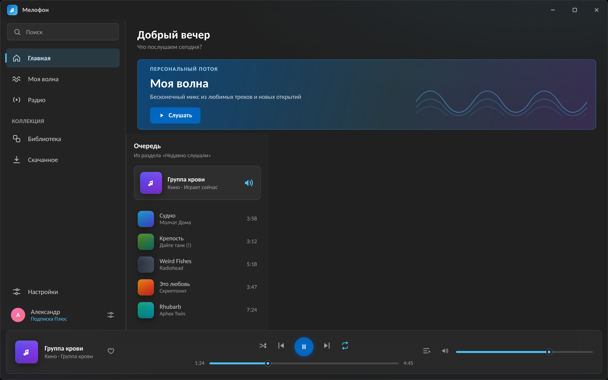
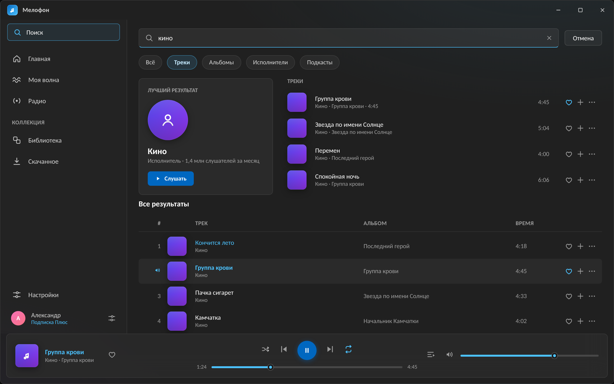
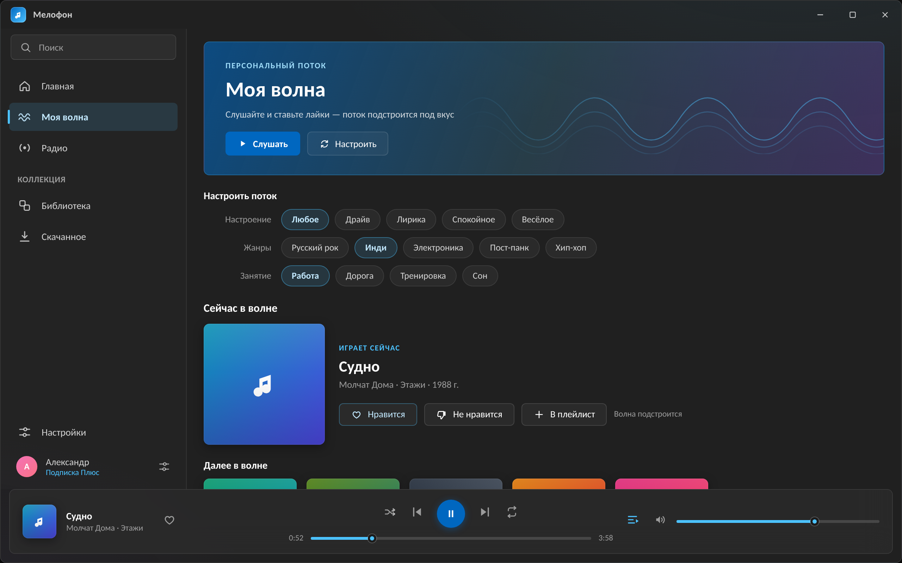
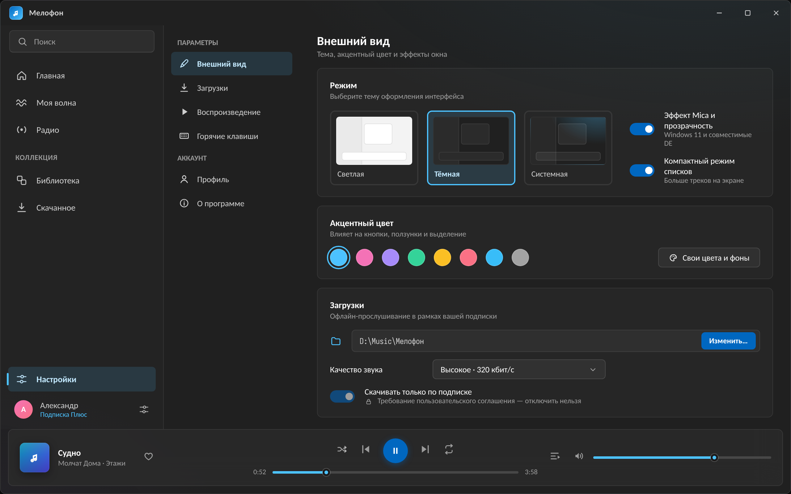

<div align="center">

# 🎧 Auris

**Неофициальный нативный клиент Яндекс.Музыки**

`Rust` · `Slint` · `rodio` · без WebView · без Electron

*Лёгкий. Законопослушный. Ваш.*

[Возможности](#-возможности) · [Скриншоты](#-дизайн) · [Сборка](#-сборка) · [Правовая позиция](#%EF%B8%8F-правовая-позиция) · [Дорожная карта](#%EF%B8%8F-дорожная-карта)

**Статус: `0.0.1a` — ранняя альфа.** Приложение не тестировалось на живом API и находится в активной разработке.

</div>

---

## ✨ Возможности

| | |
|---|---|
| 🔐 **Вход без пароля** | OAuth Device Flow: QR-код или ссылка `ya.ru/device` — пароль приложение не запрашивает никогда |
| ▶️ **Воспроизведение** | rodio + symphonia: MP3/AAC/FLAC/OGG, перемотка, громкость, повтор, перемешивание |
| 🌊 **Моя волна** | Новый Rotor Session API: персональный поток, лайк/дизлайк с обучением станции |
| 📻 **Радио** | Станции по жанрам и занятиям |
| 🔎 **Поиск** | Лучший результат + таблица треков |
| 📚 **Библиотека** | Плейлисты, «Мне нравится», история прослушиваний |
| ⬇️ **Скачивание** | Только по официальным ссылкам и только при действующей подписке; папка и качество настраиваются |
| 🎨 **Кастомизация** | 6 тем: Fluent Dark/Light, тёплая и мятная пастель, монохром + свой акцентный цвет |
| 🖥️ **Медиа-клавиши** | SMTC в Windows, MPRIS в Linux (`--features media-controls`, включено по умолчанию) |
| 🔒 **Токен в keyring** | Windows Credential Manager / macOS Keychain / Secret Service, файловый fallback |
| 🪶 **Легковесность** | Один бинарник, нативный UI, кеш обложек и аудио с очисткой из настроек |

## 📐 Дизайн

UI повторяет дизайн-макеты Win11 Fluent (тёмная тема — по умолчанию, все цвета из мокапов перенесены в дизайн-токены):

| Главная | Поиск |
|:---:|:---:|
|  |  |

| Моя волна | Настройки тем |
|:---:|:---:|
|  |  |

*Это дизайн-макеты; альфа-версия реализует их структуру и стилистику (скриншоты живого приложения появятся после обкатки на реальном API).*

Сравнение GUI-фреймворков (почему Slint) — в [`docs/design/`](docs/design/).

## 🚀 Сборка

```bash
# Linux: системные зависимости
sudo apt install libasound2-dev libfontconfig1-dev pkg-config

git clone https://github.com/VinylRUS/Auris.git
cd Auris
cargo run --release
```

Windows и macOS собираются без системных зависимостей (`rustls`, стандартный toolchain).

Сборочные флаги: `--no-default-features` — без SMTC/MPRIS.

### Структура

```
crates/
├── auris-api      # клиент API Яндекс.Музыки (reqwest, Device Flow, golden-тесты)
├── auris-player   # плеер-сервис (rodio + symphonia) в отдельном потоке
├── auris-core     # конфиг, темы, keyring, кеш, загрузки, история
└── auris          # приложение: Slint UI + оркестрация
    └── ui/        # .slint-файлы интерфейса
```

## ⚖️ Правовая позиция

**Auris — неофициальный проект, не аффилированный с Яндексом.**

1. **Никакого обхода DRM.** Зашифрованный контент (encraw) не разбирается и не расшифровывается — это красная линия проекта. Все ссылки на аудио берутся только из официального `download-info`, который API отдаёт сам.
2. **Скачивание только по подписке.** Без «Плюса» API не помечает варианты как `direct` — Auris честно сообщает, что скачивание недоступно.
3. **Штатная авторизация.** OAuth Device Flow с публичными кредами Android-приложения — тот же механизм, что использует [открытая спецификация сообщества](https://ym.marshal.dev) (MarshalX/yandex-music-api, LGPL).
4. **Уважение к сервису.** Никакого массового парсинга, бэкапов каталога или раздачи контента. Auris — плеер для личной подписки, не пиратский инструмент.
5. **Товарные знаки.** Проект называется Auris и не использует бренд «Яндекс» в названии и иконке.

**Лицензия кода — [GPLv3](LICENSE).** Slint используется под GPL (вариант лицензии для open-source проектов).

## 🗺️ Дорожная карта

- [x] **0.0.1a** — каркас: вход, поиск, волна, плейлисты, скачивание, темы, SMTC/MPRIS *(текущая)*
- [ ] **0.1** — обкатка на живом API, gapless-переходы, мини-режим, автопродолжение
- [ ] **0.2** — настройки волны (настроение/жанры), Ynison-синхронизация между устройствами
- [ ] **0.3** — тексты песен, похожие треки, эквалайзер
- [ ] **1.0** — автообновление, установщики (MSIX/DEB/DMG), стабильный API-крейт отдельно

## 🛠️ Отладка

```bash
RUST_LOG=debug cargo run          # подробные логи
cargo test -p auris-api           # golden-тесты моделей (без сети)
```

Конфиг: `~/.config/auris/config.json` · Кеш: `~/.cache/auris/` · История: `~/.local/share/auris/history.json`

## 🤝 Вклад

PR приветствуются! Перед крупными изменениями откройте issue. Особенно ждём:
- тестирование на реальных аккаунтах (Win/macOS/Linux);
- фиксы парсинга ответов API (golden-тесты в `crates/auris-api/tests/`);
- доработку .slint-компонентов под вашу платформу/тему.

## ⚠️ Отказ от ответственности

Использование сторонних клиентов может противоречить условиям сервиса. Проект существует для персонального использования с действующей подпиской и образовательных целей. Ответственность за использование — на пользователе.
